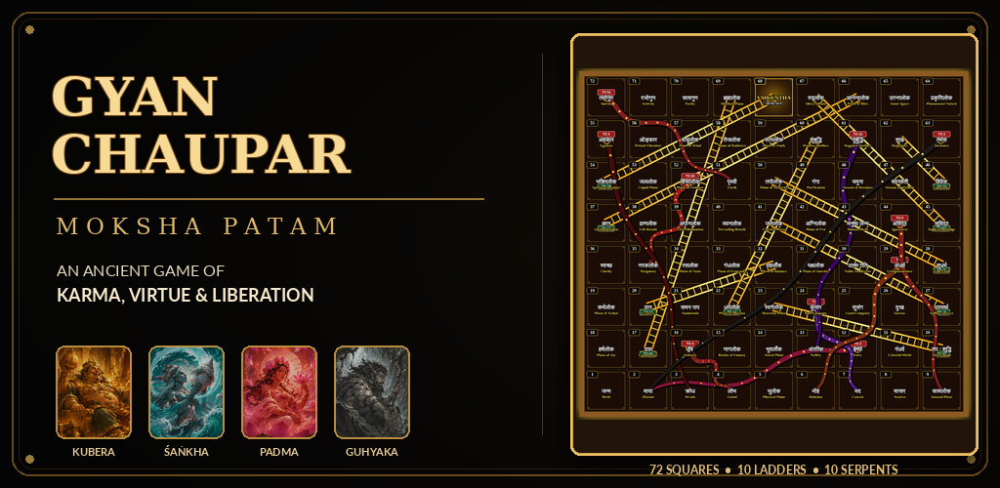

# Gyan Chaupar · ज्ञान चौपड़ (Moksha Patam)

<p align="center">
  
</p>

<p align="center">
  <strong>The ancient 72-square Indian board game of karma, virtue, and spiritual liberation.</strong><br>
  <em>Reconstructed and packaged as a standalone Android APK.</em>
</p>

<p align="center">
  <a href="https://github.com/gauranshbansal/gyan-chaupar-game/raw/main/assets/Gyan-Chaupar.apk"></a>
  
  
  
  
</p>

<p align="center">
  <a href="https://gauranshbansal.github.io/gyan-chaupar-game/"><strong>🌐 Official Download Page</strong></a> &nbsp;•&nbsp;
  <a href="https://github.com/gauranshbansal/gyan-chaupar-game/raw/main/assets/Gyan-Chaupar.apk"><strong>⬇ Direct APK Download</strong></a> &nbsp;•&nbsp;
  <a href="https://www.linkedin.com/in/gauransh-bansal-a71223239/"><strong>LinkedIn</strong></a> &nbsp;•&nbsp;
  <a href="https://github.com/gauranshbansal"><strong>GitHub</strong></a>
</p>

---

## 🌿 How This Was Built (The Honest Version)

The spark was simple: I was scrolling Instagram and stumbled across [this reel](https://www.instagram.com/reel/Dey_O80MbTK/?rpxt=aWE1OXh1eWFpcG1r) explaining how *Snakes and Ladders* was originally a deeply philosophical 72-square Vedic/Jain game called **Gyan Chaupar (Moksha Patam)**. The history fascinated me, and my immediate reaction was: *let's actually build it*.

I have been building personal utility apps for a while—like `monyp`, a custom app I made to motivate my own savings habits—and I’ve spent years working with storytelling, visual design, and video production. Naturally, I thought: *"I have the design and narrative experience down; making this game will be a breeze."*

**It was not a cakewalk.**

I’m not a software engineer by degree. I’m an engineer by curiosity and passion—meaning when an idea grabs hold of me, I will learn whatever math, code, or tools are necessary to bring it into reality.

### Leveraging AI With Clear Intent
To bridge the gap between concept and code, I heavily leveraged AI tools for technical research, boilerplate generation, and debugging. 

AI handled the syntax and accelerated the research, but:
- The **creative direction and philosophy** were guided by hand.
- The **game architecture, rules, and 72-square karmic state transitions** had to be researched, verified, and tuned.
- The **carved 3D visual aesthetic, textures, and Yaksha lore** came from deliberate artistic choices.
- Knowing **how to prompt, steer, debug, and connect fragmented code into a real, working Android binary** took hours of iteration and problem-solving.

Even with AI as an amplifier, wrestling with WebGL coordinate spaces, 6-cowrie shell probability models, Android WebView asset paths, and zero-bloat APK packaging was a humbling technical grind. But the product is here, it’s 100% offline, and I’ll let the game speak for itself.

---

## 📜 The Core Concept

Centuries before it was commercialized into *Snakes & Ladders* in 1892, **Gyan Chaupar** was a contemplative map of existence:
- **72 Cosmic Squares** tracing the soul's journey through worldly existence (*Samsara*) toward liberation (*Vaikuntha / Moksha*).
- **Ladders of Virtue (*Dharma Soapan*)**: Virtues like *Daya* (Compassion), *Tapa* (Ascetic discipline), and *Bhakti* (Devotion) propel the player upward.
- **Serpents of Karma (*Sarpa Dansha*)**: Vices like *Krodha* (Wrath), *Lobha* (Greed), and *Irshya* (Envy) swallow the player back to lower planes.
- **Four Yaksha Guardians**: Choose your patron guardian—*Kubera*, *Śaṅkha*, *Padma*, or *Guhyaka*.
- **Three Play Modes**: *Classic Patam*, *Yama's Vacation*, and *Shakti Mode*.

---

## 📲 Android APK Installation

### Specifications
- **Direct Download:** [`assets/Gyan-Chaupar.apk`](assets/Gyan-Chaupar.apk)
- **Version:** `v1.4`
- **File Size:** `22.12 MB` (23,195,692 bytes)
- **Target OS:** Android 8.0 (Oreo) through Android 15+
- **Architecture:** Universal (ARM64, ARMv7, x86_64)
- **Permissions:** None required (Runs in an offline, self-contained sandbox)
- **Network Access:** Zero (100% playable offline, even in Airplane Mode)

### Step-by-Step Sideload
1. Download [`Gyan-Chaupar.apk`](assets/Gyan-Chaupar.apk) to your Android device.
2. Tap the downloaded file in your browser or File Manager.
3. If prompted with *"For your security, your phone is not allowed to install unknown apps"*:
   - Tap **Settings** → toggle **Allow from this source**.
4. Tap **Install** and launch the game.

---

## 🛡️ Cryptographic Integrity (SHA-256)

All official builds of `Gyan-Chaupar.apk` distributed here match this exact SHA-256 hash:

```text
BC498A0449F7C327D17DC2C02E8968142A5216D5DA1815126C9C97F1DED011C8
```

Verify it locally in terminal:
```bash
# Windows PowerShell
Get-FileHash -Path assets/Gyan-Chaupar.apk -Algorithm SHA256

# Linux / macOS
sha256sum assets/Gyan-Chaupar.apk
```

---

## 🏛️ The Four Yaksha Guardians

| Glyph | Guardian | Epithet | Mechanical Trait |
|:---:|---|---|---|
| **कु** | **Kubera** | Lord of True Wealth | Resilience across squares of greed (*Lobha*) and temporal attachment. |
| **शं** | **Śaṅkha** | The Sacred Resonance | Divine conch sound; dispels serpentine delusions in lower planes. |
| **प** | **Padma** | Lotus Purity | Untainted ascension; bonus progress across virtue ladders. |
| **गु** | **Guhyaka** | Master of Hidden Ways | Mystic knowledge of karmic shortcuts and cowrie dice manipulation. |

---

## 📂 Repository Structure

```text
gyan-chaupar-game/
├── .github/
│   └── workflows/
│       └── deploy-pages.yml      # Automated GitHub Pages CI/CD
├── assets/
│   ├── Gyan-Chaupar.apk          # Official signed Android APK (v1.4, 22.1 MB)
│   ├── SHA256SUMS                # Checksum verification file
│   ├── hero.png                  # Frontispiece cover artwork
│   ├── board.png                 # In-game 72-square board screenshot
│   ├── welcome.png               # Welcome portal screenshot
│   ├── setup.png                 # Player setup and Yaksha selector
│   └── campaign.png              # 10-panel lore tapestry artwork
├── index.html                    # Official APK download landing page
├── CONTRIBUTING.md               # Contribution guidelines
├── LICENSE                       # MIT License
├── README.md                     # Project documentation
└── SECURITY.md                   # Security and integrity policy
```

---

## 👨‍💻 Creator

**Gauransh Bansal**  
*Curious builder, visual storyteller, and creative technologist.*

- **LinkedIn:** [linkedin.com/in/gauransh-bansal-a71223239](https://www.linkedin.com/in/gauransh-bansal-a71223239/)
- **GitHub:** [@gauranshbansal](https://github.com/gauranshbansal)
- **Email:** [gauranshbansal2205@gmail.com](mailto:gauranshbansal2205@gmail.com)

---

## 📄 License

This software is released under the **[MIT License](LICENSE)**. © 2026 Gauransh Bansal.
